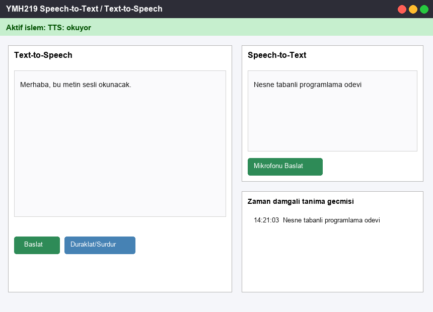
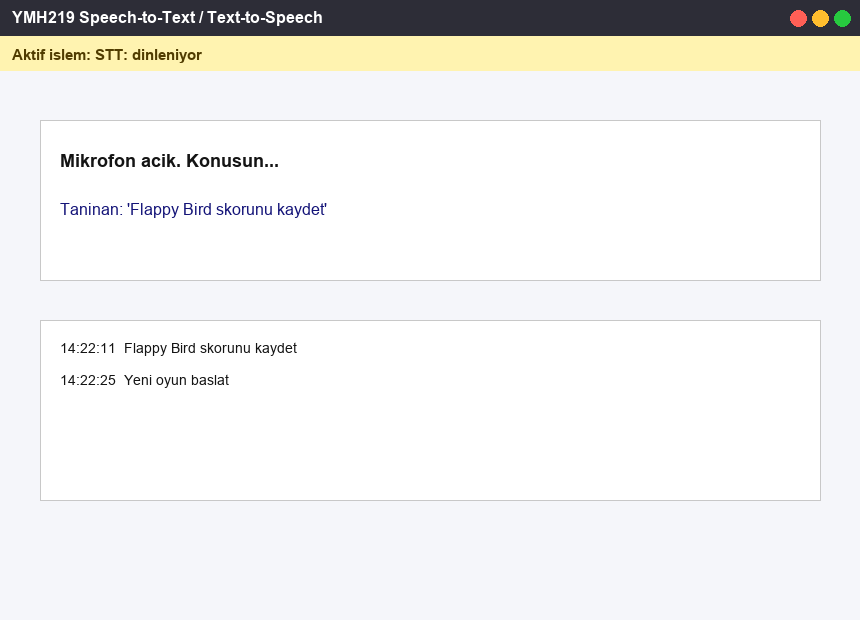

# YMH219-SpeechApp

Windows Forms uygulaması: yazılan metni sesli okur (TTS) ve mikrofondan konuşmayı metne çevirir (STT).

**Öğrenci:** Sıla Ağgül  
**Öğrenci No:** 250541020  
**Ders:** Nesne Tabanlı Programlama (YMH 219)

## Kullanılan teknolojiler / NuGet

- C# / .NET 8
- Windows Forms
- `System.Speech` 8.0.0 (`SpeechSynthesizer`, `SpeechRecognitionEngine`)

Windows’un yüklü konuşma sesleri ve konuşma tanıma dil paketleri kullanılır.

## Temel özellikler

- TTS: Başlat, Duraklat/Sürdür, Durdur, Temizle
- Ses seçimi ve hız ayarı
- STT: varsayılan mikrofon, tanıma metin kutusuna yazılır
- Aktif işlem durumu (okuyor / dinleniyor / durdu)
- Mikrofon veya motor yoksa anlaşılır hata
- Metni `.txt` kaydetme
- Tanıma sonuçları zaman damgasıyla listelenir

## Kurulum ve çalıştırma

1. Windows 10/11, Visual Studio 2022, mikrofon izni.
2. Ayarlar → Zaman ve dil → Konuşma: en az bir ses ve tanıma dili kurulu olsun (Türkçe yoksa `en-US` denenebilir).
3. `YMH219-SpeechApp.sln` dosyasını açıp F5.

```powershell
dotnet restore
dotnet run --project SpeechApp
```

İlk mikrofon kullanımında Windows izin isteyebilir.

## Ekran görüntüleri

### Text-to-Speech



### Speech-to-Text



## Bilinen sınırlamalar

- `System.Speech` yalnızca Windows’ta çalışır.
- Tanıma kalitesi sistem dil paketine bağlıdır; Türkçe paket yoksa İngilizce motor kullanılabilir.
- İnternet tabanlı Azure Speech kullanılmaz; çevrimdışı Windows API’sidir.
